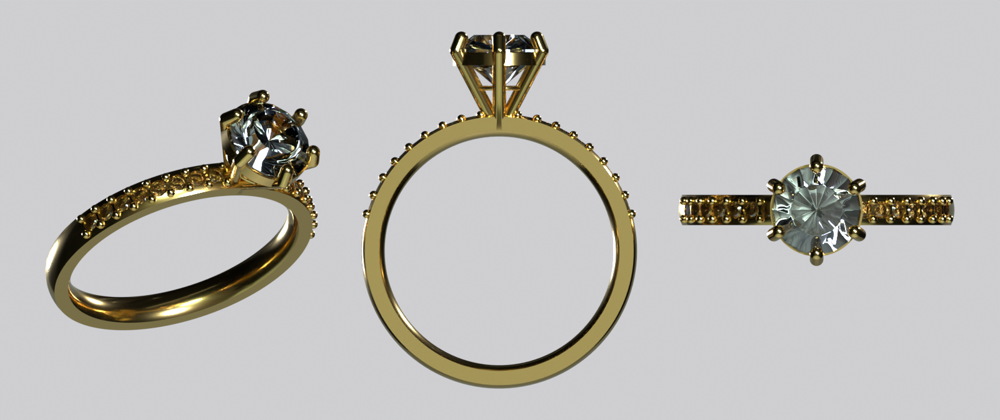
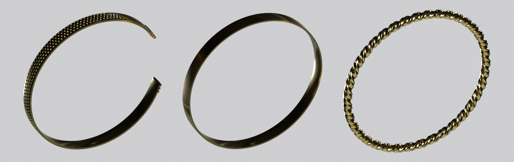
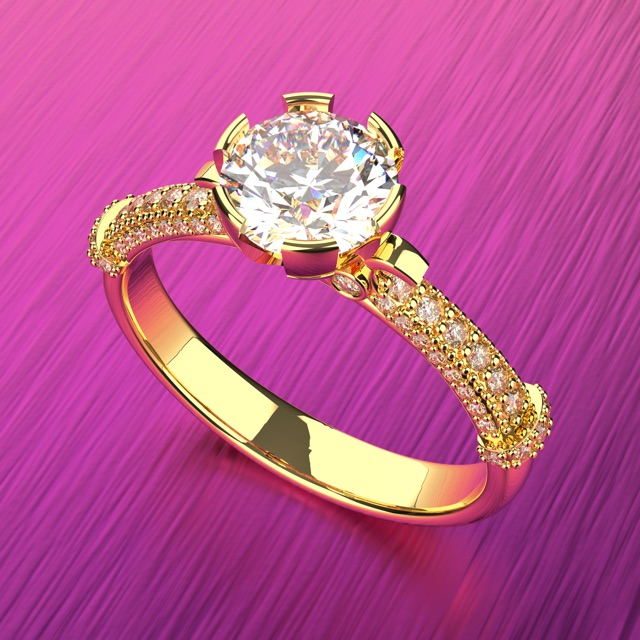
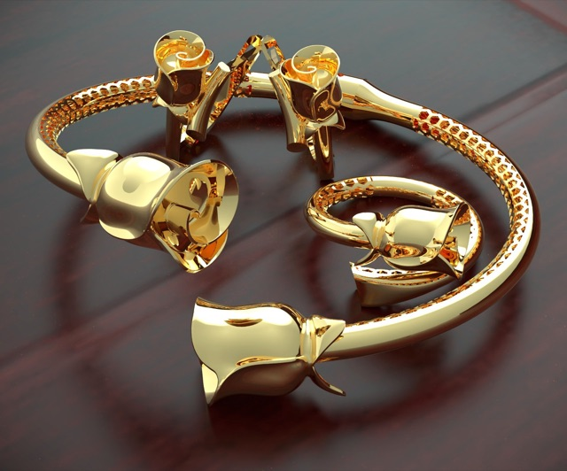

# parametric-ring

Python + CadQuery scripts that generate jewelry from a few numbers. The solitaire ring has a 6-prong crown head with a collar and pavé shoulders. The bangle (Turkish *bilezik*) can be plain, a twist or textured, closed or an open cuff. Each script writes a manufacturable STEP and STL, an STL of the stones, and a `report.json` with the metal weight and manufacturability warnings.




| Original Rhino/Matrix Gold render | Generated from code |
|---|---|
|  |  |
|  |  |

More ring variants: [docs/ring-variants.png](docs/ring-variants.png). The left image is US 6 with 4 prongs and no pavé. The right image is US 7 with an 8 mm stone and 6 × 1.5 mm pavé.

## Quick start

```sh
uv venv --python 3.12 .venv
uv pip install --python .venv/bin/python -r requirements.txt
.venv/bin/python ring.py --size-us 6 --stone-mm 6.5 --prongs 6      # -> out/ring.step, ring.stl, stone.stl, report.json
.venv/bin/python bangle.py --target-grams 20 --open-gap 25 --end-caps 3 --pattern texture
.venv/bin/python test_ring.py                                        # plain asserts, ~20 s
```

Warnings go to stderr. Add `--strict` to make the exit code 1 when any check fails, for example in CI.

## Ring parameters (`ring.py`)

| Flag | Default | Meaning |
|---|---|---|
| `--size-us` / `--size-eu` | US 6 | Ring size. US: d = 11.63 + 0.8128 × size mm. EU: inner circumference in mm |
| `--band-width` | 2.2 | Band width, mm |
| `--band-thickness` | 1.7 | Band thickness, mm (comfort-fit profile) |
| `--stone-mm` | 6.5 | Centre stone diameter (6.5 mm ≈ 1 ct round brilliant) |
| `--prongs` | 6 | 4 or 6 |
| `--setting-height` | 4.5 | Girdle height above the band top, mm |
| `--prong-mm` | 1.0 | Prong wire diameter |
| `--pave` / `--pave-mm` | 8 / 1.3 | Pavé stones per shoulder (0 = off) and their diameter |
| `--metal` | 18k | 18k, 14k, 22k, sterling, platinum |

These checks produce warnings: band thinner than 1.2 mm; prong thinner than 0.8 mm; prongs leaning more than 45° (stone too wide for the band); culet less than 0.3 mm above the band; pavé too wide for the band or too little metal under the seats; and an invalid solid.

Example `out/report.json` (default ring, 18k):

```json
{
  "inner_diameter_mm": 16.51,
  "metal_volume_mm3": 218.5,
  "metal_weight_g": 3.39,
  "parameters": { "size_us": 6.0, "prongs": 6, "stone_mm": 6.5, "pave": 8, "pave_mm": 1.3, "metal": "18k", "...": "..." },
  "warnings": []
}
```

## Bangle (`bangle.py`)

| Flag | Default | Meaning |
|---|---|---|
| `--inner-diameter` | 62 | mm (a medium adult bangle) |
| `--width` / `--thickness` | 6 / 1.5 | mm |
| `--target-grams` | none | Solve the thickness by bisection so the finished piece (including texture and caps) weighs this much |
| `--metal` | 22k | Same metals as the ring |
| `--pattern` | plain | `plain`, `twist` (burma twist) or `texture` (hex-packed dimples) |
| `--open-gap` | 0 | Cuff opening in mm (0 = closed) |
| `--end-caps` | 0 | Raised rings at each open end |

The solved thickness and weight go into `report.json`. A thickness under 0.8 mm produces a warning. Example: a textured 22k cuff with a 25 mm gap and 3 caps, targeting 20 g, solves to 1.302 mm and 19.97 g. The textured solve takes about 2–3 minutes because every bisection step rebuilds a few hundred boolean cuts. A plain solve takes about 2 seconds.

## Regenerating the previews

The previews are rendered with Blender (headless Cycles):

```sh
.venv/bin/python ring.py --out out/ring-hero
.venv/bin/python ring.py --prongs 4 --pave 0 --out out/ring-us6
.venv/bin/python ring.py --size-us 7 --stone-mm 8 --band-width 2.6 --pave 6 --pave-mm 1.5 --out out/ring-us7
.venv/bin/python bangle.py --pattern texture --open-gap 25 --end-caps 3 --target-grams 20 --out out/bangle-cuff
.venv/bin/python bangle.py --target-grams 20 --out out/bangle-plain
.venv/bin/python bangle.py --pattern twist --width 3.5 --thickness 2.5 --out out/bangle-twist
blender -b -P render.py -- docs/ring-hero.png out/ring-hero/ring.stl+out/ring-hero/stone.stl
blender -b -P render.py -- docs/ring-variants.png out/ring-us6/ring.stl+out/ring-us6/stone.stl out/ring-us7/ring.stl+out/ring-us7/stone.stl
blender -b -P render.py -- docs/bangles.png --tilt=30 out/bangle-cuff/bangle.stl out/bangle-plain/bangle.stl out/bangle-twist/bangle.stl
```

## Limitations

- The stones are simplified: 16-sided ruled lofts with Tolkowsky-like proportions, not a real 57-facet brilliant.
- The 45° prong-lean check is a rule of thumb, not a stress analysis.
- The "platinum" density (21.45) is pure platinum. Pt950 is about 20.1–20.7 g/cm³.
- The twist bangle keeps the section diagonal at the inner diameter, so the bore is slightly larger where the flats face inward.
- The dimple texture is coarse (1.6 mm pitch). The rose-bud terminals and the pierced hex mesh in the reference bangle are not modelled. They are approximated by dimples and ribbed end caps.
- `.clean()` is skipped on the final solids because it made them invalid. The STL exports are not guaranteed watertight, but their volume matches the B-rep.

## About

Built by a jewelry CAD designer directing Claude Code (AI coding agent): I defined the jewelry constraints and checks, the agent wrote the code, and I reviewed the output.

License: MIT.
